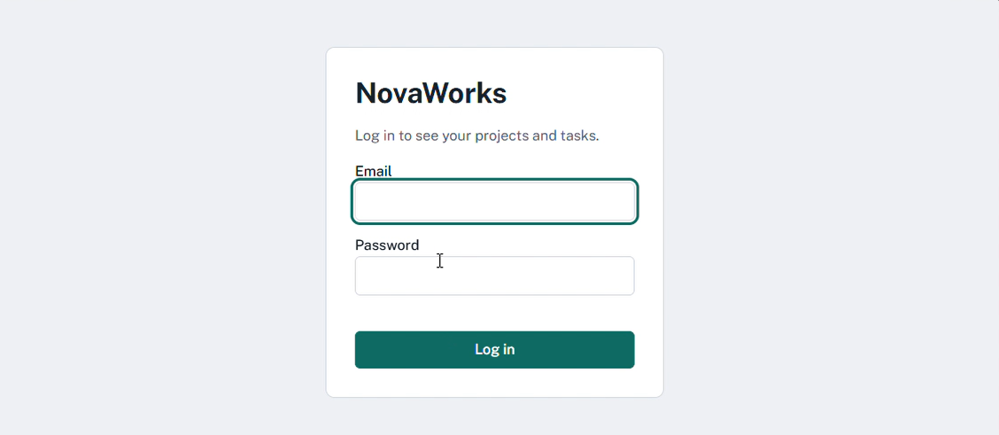
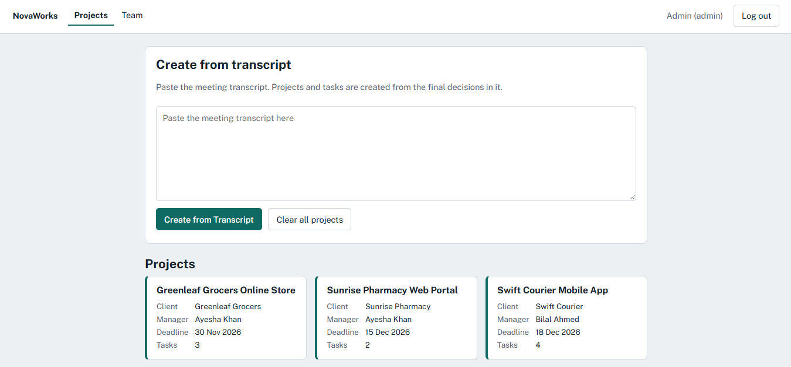
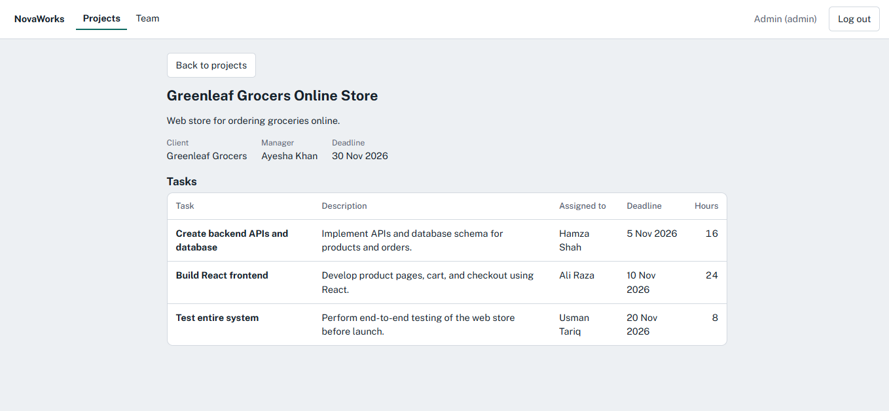
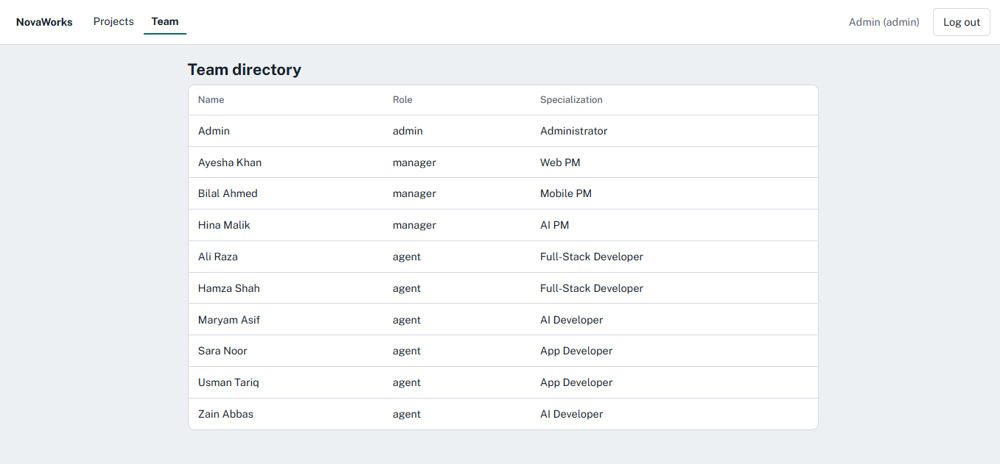
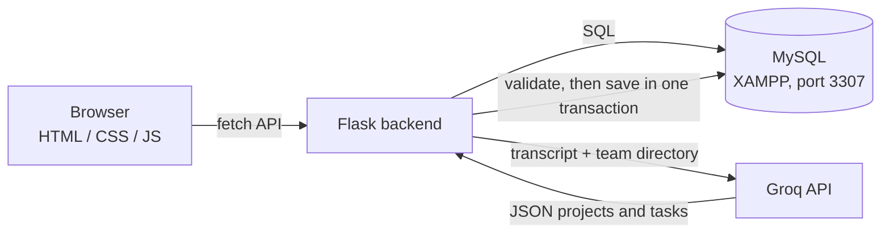

<div align="center">

# AI Project Manager

**Paste a meeting transcript. Get projects, tasks, owners, deadlines and hours, saved and ready to use.**


</div>

---

## What is this?

NovaWorks is a small project-management CRM built as a **full-stack web application**. An admin pastes the notes from a client meeting, and an AI model reads them and creates the **projects and tasks** automatically: who does what, how many hours it takes, and when it is due. Everything is saved in MySQL, and every person then logs in and sees **only the work they are allowed to see**.

## Screenshots

| Login | Admin home (create from transcript) |
|---|---|
|  |  |

| Project detail | Team directory |
|---|---|
|  |  |

## Features

- **AI transcript conversion:** one click turns a meeting transcript into projects and tasks.
- **Final decisions only:** the AI follows the latest agreed value when something is corrected, and ignores rejected ideas.
- **No invented people:** owners must come from the team directory, otherwise the result is rejected.
- **Validation with readable errors:** managers, assignees, hours and dates are checked before anything is saved.
- **All-or-nothing save:** projects and tasks are written in a single database transaction.
- **Role-based access, enforced in the backend:** admin, manager and agent see different data.
- **Clean web interface:** login, project cards, project detail with task table, My Tasks, team directory.
- **Retry on overload:** automatic retries and a backup model if the AI service is busy.

## How it works



1. The admin pastes a transcript and clicks **Create from Transcript**.
2. Flask sends the transcript and the team directory (names, roles, ids, never passwords) to the AI.
3. The AI returns JSON with projects and tasks.
4. Flask validates it (real manager, real assignee, hours above 0, valid dates, task date not after project date).
5. If it is valid, everything is saved in MySQL. If not, nothing is saved and the problems are listed.

## Who sees what

| Role | Projects | Tasks | Extra |
|---|---|---|---|
| **Admin** | All projects | All tasks | Create from Transcript, Clear all projects |
| **Manager** | Only projects they manage | All tasks in those projects | |
| **Agent (developer)** | Only projects containing their tasks | Only their own tasks | My Tasks page |

These rules are enforced in the backend, so calling the API directly cannot bypass them.

## Tech stack

| Layer | Technology |
|---|---|
| Frontend | HTML, CSS, JavaScript |
| Backend | Python, Flask |
| Database | MySQL (run through **XAMPP**, port **3307**) |
| AI | Groq API |

## Getting started

### 1. Prerequisites
- Python 3.10 or newer
- [XAMPP](https://www.apachefriends.org/) (used only to run the MySQL server)
- MySQL Workbench (optional, handy for running `schema.sql` and viewing data)
- A Groq API key from [console.groq.com/keys](https://console.groq.com/keys)

### 2. Run MySQL through XAMPP on port 3307
This project uses the MySQL server from XAMPP on **port 3307**, so it does not clash with any other MySQL installed on port 3306.

1. In XAMPP, click **Config** on the MySQL row and open `my.ini`.
2. Set **both** `port=` lines (under `[client]` and `[mysqld]`) to `3307`, then save.
3. Click **Start** on MySQL. It should turn green and show port **3307**. Apache is not needed.
4. XAMPP's `root` user has an empty password by default.

If you use MySQL Workbench, create a connection with host `127.0.0.1`, port `3307`, user `root` and an empty password.

### 3. Install the project
```bash
git clone <your-repo-url>
cd novaworks

python -m venv venv
venv\Scripts\activate          # Windows
# source venv/bin/activate     # macOS / Linux

pip install -r requirements.txt
```

### 4. Configure the environment
```bash
copy .env.example .env         # Windows   (macOS / Linux: cp .env.example .env)
```
Open `.env` and fill it in:
```env
SECRET_KEY=change-me
API_KEY=your-groq-api-key
AI_MODEL=openai/gpt-oss-120b

DB_HOST=localhost
DB_PORT=3307
DB_USER=root
DB_PASSWORD=
DB_NAME=novaworks
```
`DB_NAME` must be `novaworks` (the database created by `schema.sql`). Never commit `.env`.

### 5. Create the database and the demo users
Make sure MySQL is running in XAMPP, then create the tables with **either** option:

- **MySQL Workbench:** open your connection, choose *File, Open SQL Script*, select `schema.sql`, and run it with the lightning bolt.
- **Command line:**
  ```bash
  C:\xampp\mysql\bin\mysql.exe -u root -h 127.0.0.1 -P 3307 < schema.sql
  ```

Then create the 10 demo users (safe to run again):
```bash
python seed.py
```

### 6. Run the app
```bash
python app.py
```
Open **http://127.0.0.1:5000**. Every time the server restarts, you are asked to log in again.

## Demo accounts

Password for **all** accounts: `Demo123!`

| Role | Email |
|---|---|
| Admin | `admin@novaworks.example` |
| Managers | `ayesha@`, `bilal@`, `hina@` |
| Agents | `ali@`, `hamza@`, `sara@`, `usman@`, `zain@`, `maryam@` |

All emails end with `@novaworks.example`.

## Try it

1. Log in as **admin**, paste a meeting transcript into the box, and click **Create from Transcript**.
2. Open a project card to see its tasks, owners, deadlines and hours.
3. Log out and log in as a **manager**: only that manager's projects are visible.
4. Log in as an **agent**: only that person's tasks (and the projects they belong to) are visible.
5. As admin, click **Clear all projects**, change a value in the transcript (for example an estimate or a deadline), and create again. Only the affected task should change.

## API overview

| Method | Endpoint | Access |
|---|---|---|
| POST | `/api/login`, `/api/logout` | Everyone |
| GET | `/api/me` | Logged in |
| GET | `/api/projects`, `/api/projects/<id>` | Filtered by role |
| GET | `/api/my-tasks` | Agents |
| GET | `/api/team` | Logged in |
| POST | `/api/create-from-transcript` | Admin only |
| POST | `/api/reset` | Admin only |

## Project structure

```
novaworks/
├── app.py              # Flask routes, access control, AI call, validation, saving
├── seed.py             # Creates the 10 demo users
├── schema.sql          # Database and tables
├── requirements.txt
├── .env.example        # Settings template (no real keys)
├── templates/
│   └── index.html      # Single page shell
├── static/
│   ├── app.js          # Screens and API calls
│   └── style.css
└── docs/screenshots/   # Images used in this README
```

## Environment variables

| Variable | Purpose |
|---|---|
| `SECRET_KEY` | Flask session signing key |
| `API_KEY` | Groq API key |
| `AI_MODEL` | Groq model id |
| `DB_HOST`, `DB_PORT` | MySQL host and port (`localhost`, `3307` with XAMPP) |
| `DB_USER`, `DB_PASSWORD` | MySQL login (XAMPP default: `root` with an empty password) |
| `DB_NAME` | Database name (`novaworks`) |

## Troubleshooting

| Problem | Fix |
|---|---|
| `Can't connect to MySQL server` | Start MySQL in XAMPP and check that `DB_PORT=3307`. |
| `Unknown database` | Run `schema.sql` first, and check `DB_NAME=novaworks`. |
| `Access denied for user 'root'` | Check `DB_PASSWORD` and that the port is `3307`, not `3306`. |
| MySQL will not start in XAMPP | Another program is using the port. Use port 3307 as described above. |
| AI error 401 | The API key is wrong or has extra spaces in `.env`. |
| AI error 429 or 503 | The AI service is busy or rate limited. Wait a moment and try again. |
| "The AI result needs correction" | Working as designed. Nothing was saved, and the problems are listed. Try again. |

## Security notes

- Secrets live in `.env`, which is git-ignored. Only `.env.example` is committed.
- Passwords are stored as hashes.
- Identity comes from the server session, never from the request.
- Only names, roles and skills are sent to the AI, never passwords.

## Known limitations

- No editing of projects or tasks after they are created.
- No signup or password reset (not required for this challenge).
- Demo credentials only.
- Not deployed yet.

---

<div align="center">

Built for **The Infinity Hack '26** with Flask, MySQL and Groq.

</div>
